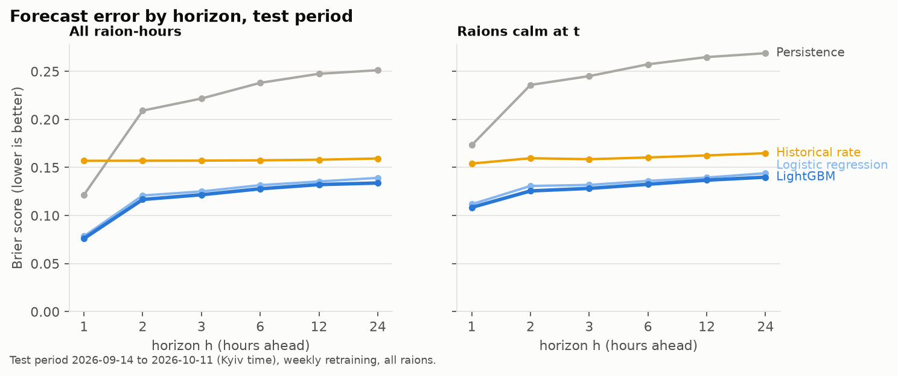
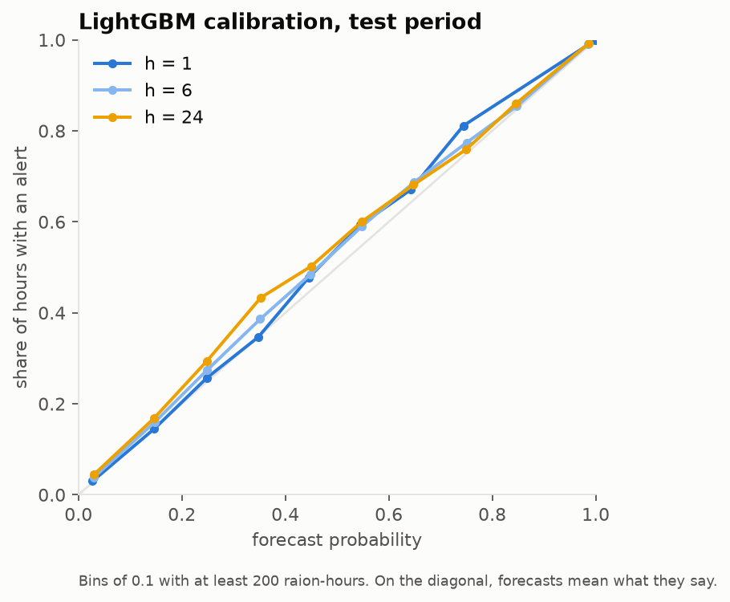
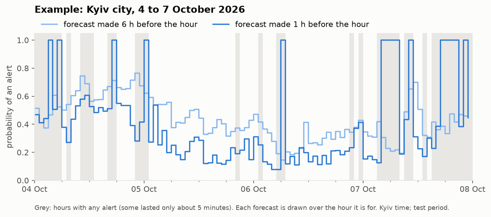

# air-alert-forecast

Forecasting air raid alerts in Ukraine from information available before the forecast is made.

For every raion (118 raions and Kyiv city) and every whole hour t, the model gives the probability that the raion
is under an air raid alert at any moment of the hour starting h − 1 hours after t, for h = 1, 2, 3, 6, 12 and 24.
It uses only what was published before t. It is meant for planning ("how likely is an alert here this evening?"),
not as a warning system: always follow official alerts.

Design, decisions and the full evaluation protocol: [docs/DESIGN.md](docs/DESIGN.md) and [docs/adr/](docs/adr/).
Terms: [CONTEXT.md](CONTEXT.md). The conversation with the AI assistant that built this:
[docs/ai-conversation.md](docs/ai-conversation.md).

## Results

**Test period: 14 September – 11 October 2026** (Kyiv time), the latest four weeks of data. Models were retrained
every week on everything known at the start of that week. All model and setting choices were made on the
validation period before it (17 August – 13 September) and the test period was run once, at the end
([`reports/test/`](reports/test/)).

| Brier score (lower is better) | h = 1 | 2 | 3 | 6 | 12 | 24 | mean |
|---|---|---|---|---|---|---|---|
| Persistence ("same as now") | 0.122 | 0.209 | 0.222 | 0.238 | 0.247 | 0.251 | 0.215 |
| Historical rate (same hour and weekday, last 4 weeks) | 0.157 | 0.157 | 0.157 | 0.157 | 0.158 | 0.159 | 0.158 |
| Logistic regression | 0.078 | 0.121 | 0.125 | 0.132 | 0.135 | 0.139 | 0.122 |
| **LightGBM** | **0.076** | **0.117** | **0.122** | **0.128** | **0.132** | **0.134** | **0.118** |



- **LightGBM is best at every horizon** and in each of the four test weeks. Its mean Brier score is 25% below the
  Historical rate baseline. Its lead over logistic regression is 0.0037 (95% interval 0.0023–0.0054, from resampling
  days, [`differences.csv`](reports/test/differences.csv)).
- **Alert starts:** for raions calm at t, LightGBM scores 0.108 one hour ahead, against 0.154 for Historical rate.
  ROC-AUC is 0.955 one hour ahead and 0.890 a day ahead.
- **The probabilities mean what they say** (below). One hour ahead, forecasts of 30–40% came true 35% of the time.
  A day ahead, mid-range forecasts run a little low: 30–40% came true 43% of the time, probably because the test
  period had more alerts than the weeks the model learnt from.
- **The test period was harder than validation** (LightGBM 0.118 against 0.109): alerts were on in 42% of
  raion-hours, against 38%.
- **17 frontline units** (Donetsk 8, Zaporizhzhia 5, Kharkiv 2, Dnipropetrovsk 1, Sumy 1) were on alert in at least 90% of
  validation hours. They are easy to forecast. Without
  them, every score rises (LightGBM 0.134, Historical rate 0.180), and the ranking stays the same.

<p>
  
</p>



In the example, the forecast made one hour ahead jumps to 1 when an alert is already on at the time it is made.
Otherwise, its probability rises and falls with the activity around the city. On the morning of 4 October, several
Kyiv alerts lasted about five minutes each. Starting from a calm hour, no forecast an hour ahead can tell which
hours will get one.

### Telegram threat posts did not help

Posts from the Air Force (`@kpszsu`) and a volunteer monitoring channel (`@deraketaua`) were turned into dated
threat events, using rules with no language model: drones, missiles, ballistic, guided bombs, aviation,
intercepts, all-clear; the places named; the time of the post or its last edit. They were tested twice on
validation, with the rule fixed in advance (keep only if the mean Brier score improves by at least 0.0005):

- **47 features** (E4): logistic regression improved by 0.0003, and LightGBM got worse.
- **7 targeted features** (E5, designed after E4 failed): logistic regression improved by 0.0004, and LightGBM got
  worse.

Neither set passed. On the test period, adding the 7 features changed LightGBM by +0.0004 (−0.0002 … +0.0011) and
logistic regression by −0.0002 (−0.0012 … +0.0006): no effect either way. Our reading, not tested: a post naming a
raion mostly arrives when its neighbours are already on alert, which the model already sees. And a post gives
minutes of warning, while the forecast is by the hour.

### How the model was chosen (validation)

Each experiment's protocol was written down and committed before it ran
([DESIGN.md, section 3](docs/DESIGN.md#3-evaluation-protocol)). Every variant's metrics are in
[`reports/validation/experiments/`](reports/validation/experiments/).

| Experiment | Winner (mean Brier) | Runner-up or default |
|---|---|---|
| E1. Training start | 1 November 2025 (LightGBM 0.1105) | 2023-01-01 0.1123; 2025-08-01 0.1127 |
| E2. One shared model or one per raion | shared (0.1105) | per raion 0.1221 |
| E3. LightGBM settings | without raion identity (0.1088) | default 0.1105; four others 0.1101–0.1117 |
| E4. All Telegram features | without (0.1088) | with 0.1091 |
| E5. Targeted Telegram features | without (0.1088) | with 0.1095 |

The scores are LightGBM's. Logistic regression made the same choices in E1, E2, E4 and E5 (E3 was for LightGBM only).

**The final model:** LightGBM, one model per horizon shared by all raions, 300 trees with 63 leaves, trained from
1 November 2025. It doesn't know which raion it is forecasting. It sees only what is happening there and around it:
- the raion's alert state and recent history (on alert now, how long, time since the last all-clear, alert starts
  in the last 1/3/6/24 h, share of the last day and week on alert);
- the share of its neighbours, its oblast and the whole country on alert, and alert starts in the last hour among
  its neighbours and nationwide;
- whether the target hour had an alert a day and a week earlier;
- the target hour, weekday and month.

## Using it

Setup:

1. Install [uv](https://docs.astral.sh/uv/), then run `uv sync`.
2. Copy `.env.example` to `.env` and fill in:
   - an [alerts.in.ua API token](https://alerts.in.ua/api-request) (only for the test-period label cross-check);
   - Telegram API credentials from [my.telegram.org/apps](https://my.telegram.org/apps).
3. Log in to Telegram once, in your own terminal:

   ```
   uv run python -m airalert telegram-login
   ```

   Telegram asks for your phone number and sends a code. The session is saved to `airalert.session`, which is git-ignored.

Forecast from the latest data:

```
uv run python -m airalert download-telegram   # all four channels; rerun to resume or to fetch new messages
uv run python -m airalert build-labels        # alert periods per raion from the channel messages
uv run python -m airalert build-telegram      # threat events from @kpszsu and @deraketaua
uv run python -m airalert train               # fit the chosen model on everything up to the last whole hour (~1 min)
uv run python -m airalert predict             # probabilities per raion and horizon (seconds; --at for an earlier hour)
```

An excerpt of real output:

```
Forecast time: 2026-10-13 00:00 Kyiv (data up to 2026-10-13 00:50); model: lightgbm, trained at 2026-10-13 00:00 Kyiv
Probability of an alert in the hour starting h - 1 hours from now:

                                       unit  on alert  h=1  h=2  h=3  h=6  h=12  h=24
                                    м. Київ      True 1.00 0.73 0.61 0.64  0.68  0.74
       Харківська область/Харківський район      True 1.00 0.88 0.86 0.85  0.91  0.90
Дніпропетровська область/Дніпровський район     False 0.62 0.62 0.62 0.62  0.70  0.67
             Одеська область/Одеський район     False 0.42 0.36 0.41 0.42  0.47  0.52
         Львівська область/Львівський район     False 0.01 0.02 0.01 0.01  0.03  0.05
```

`predict` refuses a forecast time earlier than the saved model's training cutoff, so a forecast never uses a model
that learnt from later data.

Reproduce the evaluation:

```
uv run python scripts/fetch_alerts_in_ua.py    # alerts.in.ua history, for the test-period label cross-check
uv run python -m airalert check-labels         # label quality (below)
uv run python -m airalert backtest validation  # baselines and models on validation
uv run python -m airalert experiment training-start   # then per-unit, lightgbm, telegram, telegram-targeted
uv run python -m airalert test-run             # the single test run; refuses to run again once reported
uv run python -m airalert test-report          # intervals and weekly scores from the saved predictions
uv run python scripts/make_figures.py          # docs/figures/
uv run pytest                                  # includes the leakage tests
```

Raw data goes to `data/` and saved models to `models/`; neither is committed.

## No leakage

Nothing a forecast for time t uses, and nothing its model is trained on, comes from after t
([ADR-0001](docs/adr/0001-as-of-data-model.md)). The main rules:

- **Features use only what was known before t.** An alert still on at t counts as ongoing, however long it later
  lasted. Tests compare the fast feature code with a naive "what was known at t" computation, and check that
  rewriting everything after t changes no feature at t.
- **Training labels must be known by the cutoff:** a model retrained at cutoff C only uses rows with t + h ≤ C,
  each with its label as known at C (a correction posted later is not applied yet).
- **Validation never sees the test period:** a forecast is scored only if its target hour lies inside its own period.
- **Choices are made on validation only,** each by a rule committed before the experiment ran; the test period was
  run once, with the configuration read from the validation decisions.
- **Corrections are not known early.** An alert later retracted as a mistake counts as on alert until the
  retraction was posted; only the labels drop it ([ADR-0007](docs/adr/0007-published-vs-corrected-history.md)).
- **The unit list is fixed in advance,** so a raion's first alert never changes country or neighbour features before it.
- **Edited messages.** Telegram returns only a message's latest text, dated at its original posting time. In the
  label channel every message has been edited, mostly in two channel-wide re-edits (2024-01-30 and 2025-06-27)
  and, since July 2025, automatically about 20 seconds after posting. Sampled late edits keep the channel's fixed
  wording, so edits are treated as not changing an alert's kind or place. This is an evidence-backed assumption;
  the month-by-month comparison with the independent official channel (below) is an approximate cross-check.
  Telegram threat posts follow a stricter rule: a post counts only from its last edit, so a post edited at or
  after t is not used at t (ADR-0007).

## Label quality

Labels come from the volunteer channel `@UkraineAlarmSignal` (єТривога), the only source that covers both
training and the latest weeks ([ADR-0006](docs/adr/0006-labels-from-volunteer-channel.md)). Before building on
it, we compared it with the official channel `@air_alert_ua` month by month, against a pass mark fixed in
advance: in every month, at least 98% of official alert starts and all-clears appear in our labels within 5
minutes, and vice versa. `uv run python -m airalert check-labels` writes the tables to
[`reports/label_quality/`](reports/label_quality/).

**Result: the pass mark is not met.** 33 of 176 month × kind × direction rows are below 98% (lowest 96.2%; 18
months, mostly 2023). The causes we found:

- **The channel misses some all-clears.** The alert then seems to go on for hours or days (all of Lviv oblast
  "on alert" from 3 to 15 April 2026). A stretch with no news for longer than the oblast's limit, or ended by a new
  start more than 20 minutes later, is marked **unknown**: it is neither trained on nor scored. The limits were
  calibrated on the official channel before the validation period (`scripts/calibrate_missing_all_clear.py`).
- **The channel misses some starts:** it posts an all-clear for an alert it never announced. The 5 hours before
  such an all-clear (or since the place's previous message) are marked unknown; 95% of those official alerts
  started within that window.
- **The official record has faults too:** a 4-day outage (2026-08-29 to 09-02, left out of the comparison) and
  some broken alerts of its own (e.g. 135 hours across Lviv and Chernivtsi raions in November 2025).
- A parser bug (messages with several sections, since July 2026) was found this way and fixed.

Missing messages cannot be recovered, so the message-level check still fails. **At the level the model uses,
"was this raion on alert in this hour", the labels agree with the official record on 99.5–99.7% of known
raion-hours per year (2023–2026), and on at least 97.3% in every month** (the lowest is November 2025, the month
of the official channel's own broken alert). Unknown hours: 0.3% of raion-hours in 2023, 3.6% in 2026; 1.2% of the
validation period and 0.4% of the test period. After the official channel stopped (2026-09-07), the test period
is checked against alerts.in.ua instead: every month passes (98.4–99.96%), with 99.8% hour-level agreement.

## Limitations

- **One forecast spec.** Only raion × hour × "any alert in the hour" is built. Other specs (oblasts, minutes on alert
  per day) are designed for but not implemented ([ADR-0002](docs/adr/0002-one-main-spec.md)).
- **City alert zones other than Kyiv** (Kharkiv, Zaporizhzhia, Nikopol, Marhanets, Kramatorsk, Kryvyi Rih) are folded
  into their raions. The check that would have decided whether they deserve their own units (Q16) was not done
  before the test run.
- **Labels come from a volunteer channel.** They miss some messages (above). Hours that can't be known are left
  out, but some errors surely remain.
- **The test period is four weeks of one season,** shortly after alerts got yellow and red levels (September 2026;
  both count as an alert here). Results in other periods may differ.
- **Telegram extraction is rule-based, on two channels and at hourly resolution.** Other channels, a language model,
  or forecasts by the minute might find a signal that we didn't.

## Sources and attribution

- Alert labels: Telegram channel [`@UkraineAlarmSignal`](https://t.me/UkraineAlarmSignal) (єТривога), checked against the official channel [`@air_alert_ua`](https://t.me/air_alert_ua) and [alerts.in.ua](https://alerts.in.ua).
- Threat posts: Telegram channels [`@kpszsu`](https://t.me/kpszsu) (Air Force of the Armed Forces of Ukraine) and [`@deraketaua`](https://t.me/deraketaua).
- Raion list: [ukrainian-air-raid-sirens-dataset](https://github.com/Vadimkin/ukrainian-air-raid-sirens-dataset) by Vadym Klymenko (MIT).
- Raion borders for the neighbour table: OCHA, [Ukraine – Subnational Administrative Boundaries](https://data.humdata.org/dataset/cod-ab-ukr), HDX, CC BY-IGO. Only the derived neighbour pairs (`src/airalert/reference/neighbours.csv`) are in this repo.
